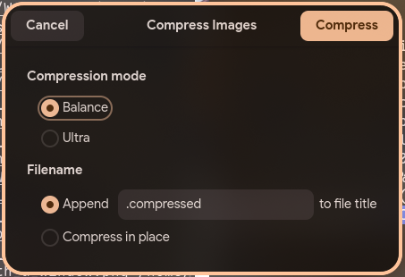
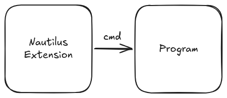

# Nautilus Image Converter Reborn - App

Application part of Nautilus Image Converter Reborn, which can help you convert, resize, and rotate images.

## Features
* **Standalone app:** It now becomes a standalone app, not binding to Nautilus File Manager anymore. However, you can still bind parent window via CLI arguments.
* **Parallelism:** Instead of processing images one by one, this app process images in parallel by rayon.
* **Launch from CLI:** As it becomes a standalone app, you can launch it form other places through CLI interface directly.

## Screenshots
||

## Limitation
* **Jpeg/Png/WebP/Avif only:** This app only supports Jpeg, Png, Webp and Avif 

## Installation
### Ubuntu (or other Debian-based distro)
Download package from [release page](https://github.com/Kayxue/nautilus-image-compressor-app/releases), and install it by double clicking on it or through command below:
```bash
sudo apt install <path-to-deb-package>
```

### Fedora (or other RedHat-based distro)
Download package from [release page](https://github.com/Kayxue/nautilus-image-compressor-app/releases), and install it through command below:
```bash
sudo dnf install <path-to-rpm-package>
```

### Arch Linux (or other ArchLinux-based distro)
First, clone the repository through Git CLI.
```bash
git clone https://github.com/Kayxue/nautilus-image-compressor-app-arch.git
```
Second, open terminal, `cd` into the folder and run command below:
```bash
makepkg -si
```

> [!NOTE]
> Becuase AUR account registration service is currently unavailable, I can't push it to AUR. If you have an account and want to push it to AUR, please open an issue to tell me.

## Architecture



## Repository

* Extensions repository: [Here](https://github.com/Kayxue/nautilus-image-compressor-extension)
* App repository: This repository

## Technology Stack 

- Rust
- gtk-rs
- Relm4
- mozjpeg-rs
- image
- imagequant
- oxipng
- webp
- ravif

## AI Contribution Policy
Similar to [gtk-rs](https://github.com/gtk-rs/gtk4-rs#ai-contribution-policy)

## Contribution
Welcome to contribute to this project. Feel free to open an issue or submit a pull request. But:
1. Please follow [Code of Conduct](https://rust-lang.org/policies/code-of-conduct/)
2. Please format files and confirm your code before pushing to GitHub
